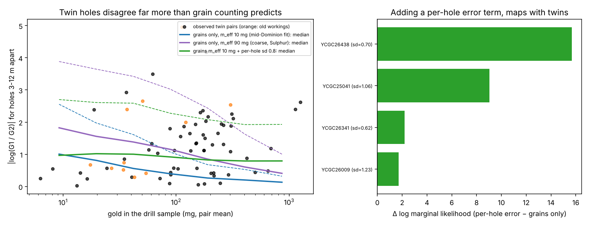
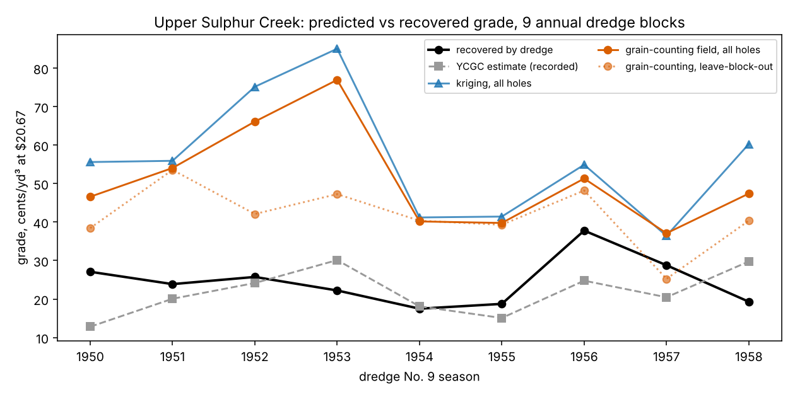
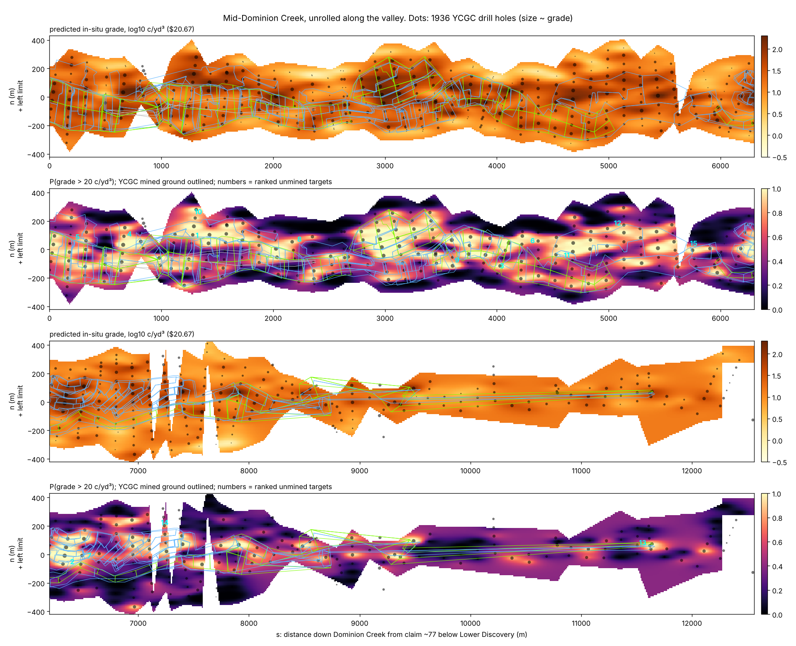

# Klondike placer gold: validated prediction from historic drilling

Can 1923–1966 Yukon Consolidated Gold Corporation (YCGC) churn-drill records,
modelled with honest spatial statistics, predict placer gold at ground the
model has not seen, well enough to rank targets for an operator?

First creek: **Middle Dominion Creek**, 612 holes from the 1936 drilling.
Technical note with derivations: [`docs/SCIENCE.md`](docs/SCIENCE.md).

## Status (24 Nov 2026)

| Stage | Status |
|---|---|
| Full YCGC dataset from the YGS map service (13,358 holes, 5,352 mined-ground polygons, 933 maps) | ✅ located, exported, audited |
| Data curation: units, price basis, duplicates, non-grade fields, transcription errors | ✅ |
| Physical measurement model (compound Poisson grain counting) + latent spatial field | ✅ derived, implemented, verified |
| Synthetic validation against known truth | ✅ 3 creeks |
| Mid-Dominion: model selection, held-out-line validation, target map | ✅ |
| Official release vs live service compared (provenance) | ✅ |
| Production check: 9 dredge blocks with recorded recovery, upper Sulphur | ✅ (negative result, see below) |
| Twin holes: decomposition of the nugget | ✅ |
| Identifiability: what each drilling design can separate (synthetic) | ✅ |
| Grain mass across 33 campaigns, profile likelihoods | ✅ (negative result) |
| Design rule: holes per block, where grain counting matters | ✅ |
| MCMC check of the Laplace grain-mass estimate | ✅ agrees within 3% |
| Check targets against post-1966 mining (imagery) | next |
| Local calibration of absolute grade (YCGC estimation factor, recovery) | next |

## Findings

**About the data**
1. **The public YCGC record needs curation before it can be modelled.**
   - Thicknesses and elevations are in feet.
   - The 1936 Middle Dominion elevations sit on a local datum.
   - 675 holes are drawn twice on different maps, about 5 m apart. That pins
     the georeferencing error.
   - Some "grades" are provably not grades. At the same spots, thaw-layout
     values read a median of 2 where the 1936 holes read 33 c/yd³.
   - At least one hole carries another hole's values.
2. **Unrecorded gold-price bases can be recovered from the data itself.** A
   hole redrawn on a map revalued at $35 reads exactly 1.690× its $20.67
   original (1.863× at $38.50). Maps with recorded prices confirm the rule,
   and it identifies two maps whose $35 and $38.50 bases were never recorded.
   Left uncorrected, those maps would read 69–86% too rich.
3. **The official download is an older, lossy release.** The zip on the
   open-data page dates from 2020 and has 2,632 fewer holes than the live
   service. Its shapefile also stores missing values as 0. As a result, 80% of
   its "zero-grade" holes were never assayed, and a model built from it would
   see the creek about 5× more barren than the records say.
4. **Van Loon's (2016) "missing" plans are in the public data.** The 1955
   Middle Dominion dredge-limit maps are redraws of the 1936 plans 1104–1105,
   with holes matching her published table value for value.

**About the method**
5. **Grain counting has a physical form.** A drill sample holds a random
   number of gold grains, so its relative variance is
   m_eff / (grade × sample volume), and a zero assay means "no grain in the
   sample". This gives an exact likelihood in place of kriging's constant
   nugget. On synthetic creeks with known truth (3 seeds), kriging log-grades
   **understates in-situ gold by about 30%**. The grain-counting model removes
   most of that bias and cuts RMSE by 15% (0.72 ± 0.004 vs 0.85 ± 0.015).
   The standard log-normal correction does not close the gap: it barely moves
   kriging and over-corrects the GP (bias +0.19, RMSE 0.80).
6. **On real mid-Dominion data it beats kriging on every held-out-line
   score.** CRPS is 1.115 against 1.210. Its 90% intervals are calibrated
   (0.915), against 0.88 for kriging and 0.86 for the GP. The top-ranked 20%
   holds 34.9% of the gold, against 27.8% for kriging. The scores are unchanged
   when a per-hole error is forced in (CRPS 1.107).
7. **On mid-Dominion the model recovers the grain size from the 1936 assays
   alone.** The effective grain mass is ~10 mg, inside the 5–20 mg range
   implied by published Dominion grain sizes and shapes. The estimate survives
   a forced per-hole error (10.0–10.5 mg) and the "fine gold plus barren
   holes" alternative, which loses by Δ log Z ≈ 30. An MCMC check gives
   10.3 mg (90%: 8.9–11.8), against the Laplace 10.5 mg. Elsewhere it does
   not generalise (finding 16).

**About the nugget: what limits a drill hole**
8. **Twin holes show the nugget is mostly not grain counting.** 78 pairs of
   holes 3–12 m apart on the same map (Bear, Gold Run, Hunker) disagree by a
   typical factor of ~3. That is ~13× the variance grain counting predicts for
   Dominion-like gold (90% interval 4–24× when whole maps are resampled;
   11× without Bear Creek). Grain counting requires the disagreement to fall
   as the gold in the sample rises; instead it rises (slope +0.26 against
   −0.38 to −0.51 for grain counting at any grain mass from 10 to 300 mg;
   within-map permutation p = 0.045).
9. **A per-hole error of a factor 2–3 is the dominant term.** Its likely
   sources are volume recovery and its correction (the 1969 BLM bulletin
   describes upward corrections of up to 2×) and metre-scale bedrock traps.
   Adding it raises the marginal likelihood on all four twin-rich maps
   (σ_h = 0.6–1.2 on the log scale).
10. **Line-spaced drilling cannot see that error, but ignoring it costs
    accuracy.** On synthetic creeks with σ_h = 0.8, the marginal likelihood
    cannot detect it (Δ log Z 0.4), yet leaving it out worsens the field
    estimate by 18%. Twinning 15% of holes makes it detectable (Δ log Z 8) and
    stabilises the grain mass (sd 3.1 → 0.1 mg). **Design advice for new
    drilling: twin 10–15% of holes.**
11. **A design rule for holes per block.** The log error of a block mean of
    n holes has variance ≈ κ²/n, with κ² = (1+h²)(1+g²) − 1,
    h² = e^{σ_h²} − 1 and g² = m_eff/(cV). Grain counting dominates only
    below m_eff/h² of gold per sample (≈ 16 mg for Dominion gold). Valley pay
    with fine gold needs 15–40 holes per block for ±20%. Lean bench ground with
    coarse gold needs 300–500, so it can only be valued by bulk sampling.

**About the geology**
12. **The pay channel is about 4× longer than wide in correlation terms**
   (≈130 m along the valley, ≈33 m across), consistent with the ~45 m-wide
   channel van Loon mapped.
13. **YCGC mined where it drilled rich.** Its dredge cuts and thaw blocks cover
   45% of the drilled floor but 78% of the drill-indicated gold.
14. **Remaining targets are mainly left-limit side pay** at the margins of the
   dredge cuts: 39 patches totalling 31.8 ha where the valley frame is reliable.
   **They have not yet been checked against post-1966 mining.** The ranking
   is robust to the per-hole error: rank correlation 0.94, and the top target
   is unchanged.
15. **Nothing predicts a meandering pay streak 1 km beyond the drilling.**
    Rank correlation is at most about 0.15 for every method, so claims about
    undrilled ground must come from geology, not interpolation.

**Negative results**
16. **Grain size cannot be mapped regionally from the assays.** Profile
    likelihoods are sharp for 29 of 33 campaigns, yet the best estimates span
    0.1–10 mg *within* Dominion Creek. They track section thickness and zero
    share, not distance from the lode source. On single campaigns of 100–250
    holes, "coarse gold" and "fine gold plus barren holes plus per-hole error"
    fit about equally well. A confident likelihood is not an identified
    quantity.
17. **No model beats YCGC's own estimates of what its dredges recovered.** On
    nine annual dredge blocks on upper Sulphur (1950–58), YCGC's estimates had
    no year-to-year skill, and the dredge recovered 23% more value than
    estimated. Even so, no model variant matched YCGC's log error. Model block
    grades also shift by tens of percent with defensible analysis choices
    (valley axis, a disputed price basis). Nine blocks cannot measure grain
    size either: their spread fits any m_eff from 0.3 to ~100 mg.
18. **So the models rank and locate ground; they don't yet forecast grade.**
    The missing pieces are YCGC's estimation factor (its block estimates are
    about half the raw mean of its own holes) and dredge recovery. A modern
    test pit is the calibration that closes the gap.







## How the research is organised

- **`DECISIONS.md`** — every research decision, the evidence for it, and what would change it.
- **`OPEN_QUESTIONS.md`** — what only a miner or geologist can answer, and which modelling choice each answer affects.
- **`DATA_SOURCES.md`** — datasets, links, licences, known data issues.
- **`docs/SCIENCE.md`** — geology, measurement model, inference, results.
- **`ROADMAP.md`** — next steps in order.
- **`paper/`** — the manuscript (`klondike_placer_drilling.tex` / `.pdf`, for *Natural Resources Research*); `paper/make_figures.py` rebuilds its figures from `reports/`.
- **`docs/PAPER_OUTLINE.md`** — the outline the manuscript was written from.

## Run it (Windows)

```bat
setup_venv.bat                                  :: .venv via py, installs requirements, runs tests
.venv\Scripts\activate
python scripts\run_synthetic_benchmark.py        :: method benchmark, no data needed
python scripts\run_physical_benchmark.py         :: grain-counting synthetic, known truth
python scripts\01b_ingest_service.py             :: full YGS export in raw\ -> audit + curated table
python scripts\05_dominion_real.py --variants base,drill,zero,full --cv
python scripts\06_dominion_targets.py            :: map + ranked targets
python scripts\06_dominion_targets.py --strip    :: unrolled valley figure
python scripts\07_sulphur_dredge_check.py        :: predicted vs recovered, 9 dredge blocks (add --price35)
python scripts\08_error_bound.py                 :: predicted error of drill-based block estimates
python scripts\09_meff_from_production.py        :: what 9 dredge blocks say about grain size
python scripts\10_regional_grain.py              :: grain mass per campaign (add --sd-hole 0.7)
python scripts\11_twin_holes.py                  :: twin holes: decomposition of the nugget
python scripts\12_grain_profiles.py              :: profile likelihoods of grain mass, 33 campaigns
python scripts\13_identifiability.py             :: synthetic: lines vs lines + twins
python scripts\14_mcmc_check.py                  :: MCMC vs Laplace for the grain mass
python scripts\15_design.py                      :: holes per block, crossover where grain counting matters
python scripts\16_robustness_checks.py           :: sigma_h and pi0 profiles, campaign alternatives, twin correlations
python scripts\17_twin_uncertainty.py            :: twin holes: map-cluster bootstrap, within-map trend test
python scripts\18_baseline_check.py              :: synthetic: kriging/GP with log-normal correction
python paper\make_figures.py                     :: figures of the manuscript
python paper\check_numbers.py                    :: checks every number in the manuscript against the outputs
python scripts\05_dominion_real.py --variants base,drillfix --cv --cv-variant drillfix --out-suffix _drillfix
```

Raw data: the four `ycgc_layer*.json` exports of the YGS map service in `raw\`
(plus the official 2020 zips, kept for the provenance comparison). Mid-Dominion
also runs from `data/interim/dominion_mid_browser_extract.csv` (890 records,
SHA-256 verified against the service).

## Layout

```
src/klondyke/
  sampling.py      compound Poisson grain-counting likelihood, drill volumes, grain masses
  physical.py      latent log-concentration field + measurement model, Laplace inference
  ycgc_service.py  map-service ingest: units, price inference, duplicates, mined-ground masks
  valley.py        valley axis and drill lines from geometry, (s, n) coordinates
  cv.py, metrics.py, baselines.py, models.py, experiment.py, synthetic.py, qc.py, units.py
scripts/           numbered pipeline steps, benchmarks
tests/             conversions, datum check, projection, CV leakage, CRPS, anisotropy, likelihood
reports/           audits, benchmark tables, Dominion results and figures
```

## Sources

van Loon, S. (2016, 2017). *Yukon Exploration and Geology* 2015, 253–280; 2016, 225–242.
Froese, D.G., Enkin, R.J., Smith, D.G. (2001). *Yukon Exploration and Geology 2000*, 159–169.
Chapman, R.J., Bond, D.P.G., LeBarge, W. (2010). *Yukon Exploration and Geology 2009*, 135–142.
Clifton, H.E., Hunter, R.E., Phillips, R.L. (1969). USGS Professional Paper 625-C.
Yukon Geological Survey, Historic placer data (map service and open data).

Contains information licensed under the Open Government Licence – Yukon.
